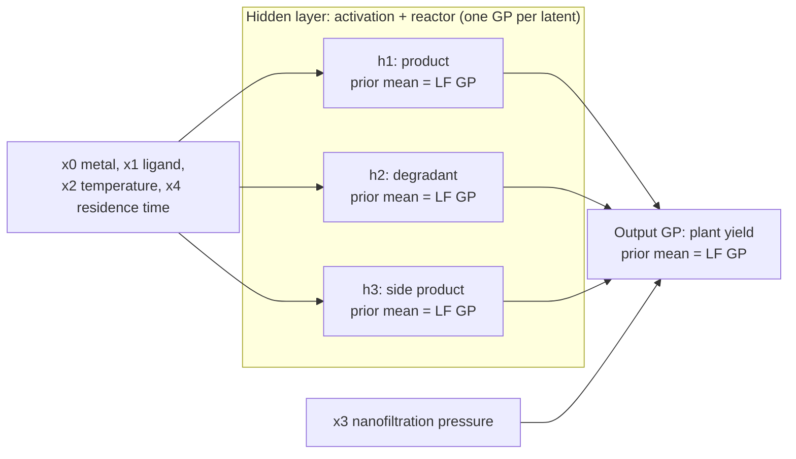

# Structure-Aligned, Prior-Informed Deep GPs for Bayesian Process Optimisation

Code for the ESCAPE-36 contribution

> **Sample-Efficient Bayesian Process Optimisation with Structure-Aligned, Prior-Informed Deep Gaussian Processes**
> C. Griehl¹, E. Baris Ercan², C. Ganzer¹, K. Sundmacher¹ ²
> ¹ Max Planck Institute for Dynamics of Complex Technical Systems, Magdeburg · ² Otto von Guericke University Magdeburg
> 36th European Symposium on Computer-Aided Process Engineering (ESCAPE-36), theme *Concepts, Methods & Tools*, submission 483

- Poster: [`escape_poster.pdf`](escape_poster.pdf)
- Extended abstract: [`escape_abstract.pdf`](escape_abstract.pdf)

This is proof-of-concept research code. The runs stored here do not reproduce Fig. 2 of
the poster. See [Results](#results) for the numbers.

## Method in brief

Bayesian optimisation (BO) of a multi-step process usually treats the plant as a black box: one Gaussian process
(GP) surrogate, no use of the flowsheet structure, and no use of cheap low-fidelity (LF)
data such as lab-scale experiments or coarse simulations of single steps. The poster and
abstract propose a surrogate that uses both, and this repository implements it.

1. The surrogate is a deep GP (DGP) whose layers follow the process steps. Each hidden
   unit is an independent GP for one latent dimension, i.e. one intermediate stream
   quantity. Inputs enter at the layer where they act physically instead of all at the
   input layer.
2. For every latent dimension, and for the output, a GP is trained on cheap LF samples of
   the matching step. Its posterior mean becomes the prior mean of the DGP node, so the
   DGP only has to learn the difference between LF physics and the high-fidelity (HF)
   plant.
3. Kernel hyperparameters and hidden latent values are sampled jointly with NUTS in
   NumPyro/JAX. The poster prefers this over variational inference because VI tends to
   underestimate the variance when there is little data.
4. The posterior draws are passed to PyTorch. A BoTorch wrapper, moment-matched over the
   draws, lets the DGP drive `LogExpectedImprovement`.

The Matérn-5/2 kernel and the prior-mean functions are written twice: in JAX for
sampling and in PyTorch for prediction. Both versions compute the same thing (the
abstract calls this "identical logic across both backends").

The diagram below shows the architecture for the 5-D pharma benchmark (poster Fig. 1,
abstract Fig. 1). The first layer covers activation and reactor. The output layer covers
nanofiltration and crystallisation.



For the polymerisation benchmarks the hidden layer has two units (effective catalyst
concentration and system temperature), and all three inputs go into it. Both
architectures are set in `BENCH_CONFIGS` in [`pretti_sad_gp/optimization.py`](pretti_sad_gp/optimization.py).

### Experimental settings

| Setting | Poster | Code |
|---|---|---|
| Initial design | 10 points | `N_INIT = 10` (`hpc_manager.py`) |
| BO iterations | 20 | `N_ITER = 20` (`hpc_manager.py`); `run_experiments.py` defaults to 40, so pass `--n_iter 20` |
| Acquisition | Log-EI, q = 1, 5 restarts / 64 raw samples | same, in both runners |
| NUTS | 1000 draws per chain, 32 chains, 500 warm-up, one GPU | `n_samples=1000`, `n_warmup=500`; 32 chains if JAX sees a GPU, else 1 |
| DGP kernel | Matérn-5/2 in both backends | Matérn-5/2 with ARD, in JAX and in PyTorch |
| LF data | 200 samples per target | 200 for the hidden nodes; the polymerisation output prior uses 400 |
| Baseline | Standard GP (black box) | BoTorch `SingleTaskGP` with its default kernel (RBF since BoTorch 0.12) and `Normalize`/`Standardize` transforms |
| Repetitions | 5 runs | seeds 0-4 |

## Repository layout

```
.
├── escape_poster.pdf, escape_abstract.pdf   ESCAPE-36 poster and abstract
├── pyproject.toml, requirements.txt         dependencies
└── pretti_sad_gp/                           all code; run scripts from this directory
    ├── optimization.py          the method: JAX/NumPyro DGP, LF priors, BoTorch wrapper, BO runners
    ├── benchmarks/
    │   ├── benchmarks.py        synthetic multi-step benchmarks (Polymerization*, Pharma*)
    │   ├── benchmark_h2_reforming_fs.py   IDAES SMR + WGS flowsheet (not used on the poster)
    │   ├── benchmark_bioethanol_fs.py     BioSTEAM sugarcane-ethanol flowsheet (not used on the poster)
    │   └── bioethanol_biorefinery.png     diagram of the bioethanol flowsheet
    ├── run_experiments.py       CLI for one run (benchmark × method × seed); checkpoints and resumes
    ├── hpc_manager.py           job list and file-lock queue: generate / init_queue / worker / audit
    ├── submit_cascade.py        submits and tops up SLURM worker arrays (GPU for DGP, CPU for baseline)
    ├── submit_jobs.sh           simple SLURM array of CPU workers
    ├── run_local.py             runs one queued job locally through the cluster code path
    ├── visualize_results.py     normalised-improvement plots in the style of poster Fig. 2
    ├── slurm_jobs.json          job list written by `hpc_manager.py generate`
    ├── convergence_plot.png, individual_reps_plot.png   plots of the stored runs
    ├── data/
    │   ├── results/             the 40 stored runs, plus trial_walltime_fit/ (NUTS timing runs)
    │   └── legacy_standardgp_200evals/   older baseline-only runs in a different file format
    ├── helper studies           check_times.py, audit_study.py, sample_and_visualize.py,
    │                            sad_gp_vs_gp.py, singletaskgp_routine.py, train_test_gp.py,
    │                            visualize_benchmark.py, run_bo_bioethanol.py
    ├── test_run_h2_reforming_fs.py   smoke tests for the H2 flowsheet
    └── tinkering_deep_gp/       scratch work from development (the another_test_v* files show how
                                 the method took shape); unmaintained and not needed for anything
```

To read the code, start with the module docstring of `optimization.py`.

## Installation

You need Python 3.10 or newer. Install the PyTorch build for your machine first, then
the rest:

```bash
python -m venv pretti_sad_gp/venv          # the SLURM scripts activate pretti_sad_gp/venv
source pretti_sad_gp/venv/bin/activate
pip install torch --index-url https://download.pytorch.org/whl/cpu   # or a CUDA build
pip install .                              # numpy, scipy, gpytorch, botorch, jax, numpyro, pandas, plotly
```

`pip install .` only pulls in the dependencies. The code is a set of scripts, not a
package you import.

Optional extras:

- `pip install ".[cuda]"` adds `jax[cuda12]` for sampling on the GPU. With a plain `jax`
  install, NUTS runs on the CPU even if PyTorch can see a GPU (`optimization.py` prints a
  warning in that case).
- `pip install ".[flowsheets]"` adds the flowsheet benchmarks. Run `idaes get-extensions`
  afterwards to get the IPOPT solver.
- `pip install ".[test]"` adds pytest.

`requirements.txt` has the same packages, core and flowsheet, if you prefer
`pip install -r`.

We tested with Python 3.12, torch 2.14 (CPU), botorch 0.18, gpytorch 1.15, jax 0.11 and
numpyro 0.22.

## Quickstart

Run everything from `pretti_sad_gp/`. The scripts import `benchmarks` and `optimization`
from the working directory.

### Local runs

```bash
cd pretti_sad_gp

# Baseline: 10 initial points + 2 BO iterations (seconds)
python run_experiments.py --benchmark Polymerization --method StandardGP --n_iter 2 --save_dir /tmp/sa_dgp

# Structure-aligned DGP with the poster settings (1000 draws x 32 chains on a GPU; hours per run)
python run_experiments.py --benchmark PharmaV1 --method CustomDeepGP --seed 0 --n_iter 20 --save_dir data/new_results

# Plot normalised improvement of all runs in a directory (opens in the browser)
python visualize_results.py --dir data/results
```

The benchmarks are `Polymerization`, `PolymerizationV2`, `PharmaV1` and `PharmaV2`, and
the methods are `StandardGP` and `CustomDeepGP`. Each run is saved as
`<save_dir>/Result_<benchmark>_<method>_Seed<seed>.pt`. If a run is interrupted, it
leaves a `.pt.partial` checkpoint, and running the same command again picks up from there.

To check the DGP path on a CPU, call the runner with a small sampler budget. This takes
about 30 s per benchmark:

```python
from benchmarks import get_benchmark
from optimization import run_custom_deep_gp_bo

bench = get_benchmark("Polymerization")
res = run_custom_deep_gp_bo(bench, n_init=10, n_iter=2, seed=0, bench_name="Polymerization",
                            n_samples=30, n_warmup=30)
print(res["history"][-1]["best_y"])
```

A result is a dict. `history` has one entry per evaluation with `iter` (0 for the initial
design), `x`, `y`, `best_y` and `train_time` in seconds. For DGP runs, `prior_data` holds
the LF samples.

### Cluster workflow (SLURM)

`hpc_manager.py` keeps a file-based queue under `data/queue_state/`. A worker claims a
job by renaming its lock file, which is atomic, so many array tasks can share the queue.
`submit_cascade.py` sends DGP jobs to GPU workers (H100 first, then A100) and baseline
jobs to CPU workers.

```bash
cd pretti_sad_gp
python hpc_manager.py generate                                # write slurm_jobs.json (skips existing results)
python hpc_manager.py init_queue --job_file slurm_jobs.json   # create pending locks
python submit_cascade.py --monitor                            # submit workers, top up every 30 s
python hpc_manager.py audit --job_file slurm_jobs.json        # count missing results
```

- Before you submit anything, set the partitions (`PARTITION_GPU`, `PARTITION_CPU`),
  `CAPACITY`, `RESOURCE_PROFILES`, `TIME_LIMIT` and `EMAIL` in `submit_cascade.py` for
  your cluster. For CPU-only runs, `sbatch submit_jobs.sh` is simpler.
- Failed jobs end up in `failed/`, and running `init_queue` again re-queues them. If
  workers were killed, e.g. at the time limit, wait until no worker is active and run
  `init_queue --requeue_running`. Those jobs then resume from their checkpoints.
- `python run_local.py --find PharmaV1 CustomDeepGP` runs a single queued job locally,
  using the same code path as the cluster.
- The poster gives roughly eight hours per DGP run. In the stored runs NUTS alone took
  5 to 6.5 h per run of 20 iterations. Baseline runs finish in minutes on a CPU.

## Benchmarks

The four benchmarks are algebraic and dimensionless, so they evaluate quickly. They still
have the step-to-step dependencies of a real process. Each one has an HF mode, which is
the "plant" that BO queries, and an LF mode, which is only used to train the prior means.
The docstrings in [`benchmarks/benchmarks.py`](pretti_sad_gp/benchmarks/benchmarks.py)
give the details.

| Name | Inputs | Steps | HF vs LF | Noise |
|---|---|---|---|---|
| `Polymerization` | 3: catalyst, monomer, temperature in [0, 1] | mixing → thermal → reaction (yield drops 10× beyond a C_eff-dependent temperature limit) | boundary shift, oscillation frequency | none |
| `PolymerizationV2` | same | same; saturating thermal step, side reaction, viscosity safety trip | rate constants, heat-exchanger efficiency, viscosity limit | none |
| `PharmaV1` | 5: metal, ligand in [0, 0.02]; temperature, NF pressure, residence time in [0, 1] | activation → reactor → nanofiltration → crystallisation | degradation rate | HF only |
| `PharmaV2` | same | same; ML2 aggregation, floored critical pressure, seeding optimum in crystallisation | degradation rate | HF only (2×) |

The poster and abstract show results for the 3-D polymerisation and the 5-D pharma
benchmark, i.e. `Polymerization` and `PharmaV1`. The H2 and bioethanol flowsheets
(`benchmark_h2_reforming_fs.py`, `benchmark_bioethanol_fs.py`) are not on the poster.

## Results

Poster Fig. 2 shows the normalised improvement (y_i - y_init) / (y_best - y_init), where
y_best is the best value found on the benchmark, as mean ± 1σ over five runs. At HF
evaluation 20 it reports 0.90 for the DGP against 0.43 for the baseline on
Polymerization, and 0.42 against a baseline plateau of at most 0.11 on Pharma.

`data/results/` holds 40 runs: 4 benchmarks × 2 methods × seeds 0-4, each with 10
initial points and 20 BO iterations. Recomputing the curves with `visualize_results.py`
(y_best is the best value any stored run reached on that benchmark) gives this mean ± std
at iteration 20:

| Benchmark | CustomDeepGP (DGP) | StandardGP | Poster (DGP / GP) |
|---|---|---|---|
| Polymerization | 0.59 ± 0.28 | 0.50 ± 0.41 | 0.90 / 0.43 |
| PharmaV1 | 0.23 ± 0.33 | 0.56 ± 0.51 | 0.42 / ≤ 0.11 |
| PharmaV2 | 0.23 ± 0.17 | 0.50 ± 0.43 | not shown |
| PolymerizationV2 | 1.00 ± 0.00 | 1.00 ± 0.00 | not shown |

So the stored runs do not reproduce Fig. 2. The DGP is slightly ahead on Polymerization,
and the baseline is ahead on both pharma benchmarks. PolymerizationV2 can't tell the
methods apart, since every run ends at the same best value of about 0.95.

Things to keep in mind when reading these numbers:

- In the stored runs, StandardGP and CustomDeepGP did not start from the same initial
  design for a given seed. The two methods ran on different devices and the design came
  from a device-dependent RNG, so the per-seed comparison is not paired. New runs draw the
  design on the CPU (`_initial_design` in `optimization.py`) and do start from the same
  points.
- After the stored runs, bug fixes changed the DGP itself (prior-mean scaling, Matérn
  kernel extraction, output-layer variance in the posterior). New runs will give
  different numbers.
- `visualize_results.py` shades a 95 % confidence interval (1.96 standard errors). The
  poster shades ±1σ.
- The poster already calls the evidence base small: two synthetic benchmark families,
  five runs each, and no comparison with multi-fidelity or grey-box baselines yet.

`data/results/trial_walltime_fit/` contains single-iteration DGP runs with 10 and 50
initial points, which `check_times.py` uses to estimate the cost of NUTS. One fit took
140 to 780 s with 10 points and 1600 to 2100 s with 50 points.
`data/legacy_standardgp_200evals/` is an older baseline-only study on Polymerization
(10 seeds, 200 evaluations each). Its files store `train_x`, `train_obj`, `history_best`
and `runtime` instead of a history, so `visualize_results.py` skips them.

## Scope and limitations

The poster lists these limitations:

- Recycle streams are not covered. Both benchmarks are feed-forward.
- Compute is the bottleneck. The cost of fully Bayesian sampling grows steeply with the
  number of data points, which caps the data-set size and the model depth.
- LF uncertainty is not propagated. Only the LF posterior means are used, as fixed prior
  means, and their variance is dropped.

## Known issues

- PharmaV1 can return negative yields. Its nanofiltration critical pressure has no lower
  bound, and in a uniform random sample about 70 % of LF yields come out slightly
  negative (down to about -0.01). PharmaV2 bounds the critical pressure, but its
  soft-minimum flux still goes slightly negative at very low pressure, for about 2 % of
  random points.
- The H2 flowsheet returns NaN when none of its 25 initialisations converges. This
  happens at low steam-to-methane ratios, roughly 1.5 to 1.9, and it makes
  `test_grid_evaluation_hf` and `test_grid_evaluation_lf` in
  `test_run_h2_reforming_fs.py` fail. Run the tests from the repository root with
  `pytest pretti_sad_gp/test_run_h2_reforming_fs.py`.
- The bioethanol benchmark returns 0.0001 for failed simulations and for IRRs that are
  not finite or lie outside [0, 1]. Four of its 25 inputs (imbibition water flow, acid
  ratio, lime ratio, wash water flow) are overwritten by flowsheet specifications and
  have no effect. Run `run_bo_bioethanol.py` from the repository root.
- Without a CUDA build of JAX (`jax[cuda12]`), NUTS falls back to the CPU with a single
  chain, which is much slower than the poster setup. The warning only appears if PyTorch
  can see a GPU.
- The helper studies (`check_times.py`, `audit_study.py`, `sample_and_visualize.py`,
  `sad_gp_vs_gp.py`, `singletaskgp_routine.py`, `train_test_gp.py`,
  `visualize_benchmark.py`, `run_bo_bioethanol.py`) are one-off scripts from development,
  and some have hard-coded paths or settings. `sad_gp_vs_gp.py` is an earlier
  composite-GP prototype, not the method from the poster.
